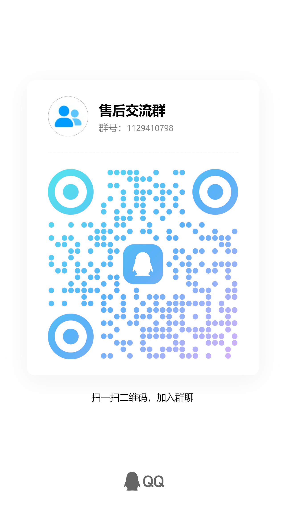

# Claude 使用环境部署指南

`claude-environment-deploy`（原名 `virtual-pc-setup`）是一套由 Agent 协助执行的虚拟电脑部署教程，帮助使用者准备独立的 Windows 环境，再配置网络、AdsPower 专用浏览器和所选 Claude 客户端。Windows x64 走 Hyper-V；Mac 按芯片选择 Fusion 与相应的 Windows 架构。

**本仓库交付的是教程、操作 Skill 和辅助脚本，目前不是全自动安装器。** Claude 模型仍在服务商处运行。新电脑完整部署、真实断线保护和 Mac 路线仍需现场验收。

**开源整理版：2026-11-12；许可证：[MIT](LICENSE)。** 以本次采购清单修订包为内容基线，保留修正版10的部署逻辑。首次使用读 [用户须知](01_用户须知.md)，准备工具读 [采购清单](02_采购清单与工具入口.md)，验证范围看 [本次发布核验](docs/发布核验_2026-11-12.md)。

## 项目沿革与 Claude-Cage 的关系

本项目在与 Claude-Cage 作者交流前，已经整理过自己的教程与辅助脚本，之后也向对方分享过已有方案。维护者声明：本仓库不是 Claude-Cage 的分支或移植，也不是通过复制其源码形成的；本次开源整理基于既有 `virtual-pc-setup` 资料包。

两者关注相近的使用需求，但交付形式和网络控制边界不同。我们尊重并感谢交流，也保留原有视频、文章及上游工具的来源说明。沿革材料、证据范围和按日期核对的技术差异见 [项目沿革与 Claude-Cage 对比](docs/项目沿革与Claude-Cage对比.md)。这份说明不代表对方授权或背书，也不用于判定双方谁最早提出同类想法。

## 致谢

Hyper-V 的搭建方法，是跟着 [技术爬爬虾 @tech-shrimp](https://www.youtube.com/@tech-shrimp) 的 [视频教程](https://www.youtube.com/watch?v=aWuRz90MHF0) 学的；VPS 和网络配置参考了 [余温 @gkxspace](https://x.com/gkxspace) 的 [分享](https://x.com/gkxspace/status/2101993381303820704)。感谢两位公开分享这些方法。Mac 分支另参考 [薛定谔的叨叨的安装视频](https://v.douyin.com/jTZQ-LRf8hM/)，并对照官方资料重写；视频安装方法不代表整套 Claude 环境已经验证。

也感谢 [@app_sail](https://x.com/app_sail)、[@suyuan1711](https://x.com/suyuan1711)、[@Nemo001ai](https://x.com/Nemo001ai)、[逸尘 @gengdaJ](https://x.com/gengdaJ)、[@zureA255062](https://x.com/zureA255062)、[@leo_xiaolei](https://x.com/leo_xiaolei)、[@JANEX0609](https://x.com/JANEX0609) 的分享。相关链接放在 [工具和购买入口](02_采购清单与工具入口.md)。

我们学习了这些方法，再按自己的配置过程编写了这份教程和配套脚本。

## 这份教程怎么用

**部署内容基线为修正版10（2026-11-07）；采购清单与开源说明更新于 2026-11-12。网络验收先查来宾防火墙和本机代理，再逐条记录 Claude 检测请求。主用和备用节点可以用分开的精确放行规则。新电脑的整套部署仍需现场验收。** 详见[第10版网络验收说明](第10版网络验收说明.md)。

第一次使用先读 [使用者须知](01_用户须知.md)，里面有解压、交给 Codex 的一句话和本人要做的事。Codex 从 [给 Codex 的操作说明](给Codex的操作说明.md) 进入，按用户的电脑和目标选择对应任务。

**部署说明**：先检查电脑，再配置环境；不先询问所在地来决定是否开始安装。Claude 的登录与使用条件在对应阶段单独处理，某个应用步骤受阻时继续其他已获授权的独立工作。

这份教程提供 Windows 和 Mac 两条虚拟电脑路线：Windows x64 用 Hyper-V；Mac 按芯片选择 VMware Fusion 与对应的 Windows 架构，再配置网络和 AdsPower，先检测当前网络后再打开 Claude。Mac 新增流程依据官方资料编写，未实机验证。

## 先按电脑选路线

| 你的电脑 | 应走的路线 | 当前边界 |
| --- | --- | --- |
| Windows x64 | 原有 Hyper-V 流程，任务文件放 D:\Codex | 原机有历史验证，新电脑完整部署仍待实测 |
| Apple 芯片 Mac | [Mac 部署流程](skills/claude-environment-deploy/references/Mac部署流程.md)：Fusion＋Windows 11 ARM64 | AdsPower 在 Windows ARM 中需先做兼容性试装，不能保证完整可用 |
| Intel Mac | 同一 Mac 流程，改用受当前 Fusion 支持的 Windows x64 | 核对 Mac、macOS 和虚拟机版本，未实机验证 |

Mac 不安装 Hyper-V，不因没有 D 盘停止；先在 Mac 上确认任务目录，再按 Mac 分支执行。五个辅助入口及一个共享帮助文件按各自用途和运行位置执行，不能拿来在 Mac 主机建机；来宾网络检查须在目标 Windows 来宾内运行，并先核实兼容性。

## Codex 做什么，你需要做什么

先准备一台能正常使用的 Windows 电脑或 Mac，装好并登录 Codex，让它能正常联网运行。Mac 用户先读上表对应的 Mac 流程。接下来，技术步骤尽量交给 Codex；账号、购买和需要本人决定的事情由你处理。

| 阶段 | Codex 负责 | 你需要做的事 |
| --- | --- | --- |
| 检查电脑 | 先核对主机系统、芯片、内存、磁盘及已有软件；Windows 检查 Hyper-V，Mac 检查所选虚拟机版本，判断复用和缺口 | 告诉它想用网页、桌面端还是完整虚拟机方案；按实际提示确认权限 |
| 准备虚拟电脑 | 先识别系统和芯片；Windows 用 Hyper-V，Mac 按专用流程用 Fusion 或已选软件；有工具时继续协助安装 Windows | 处理 Windows 许可和本人登录；确认必要的系统盘写入及物理电脑重启 |
| 来宾语言与时间 | 盘点并按已选目标设置系统语言、区域及日期时间格式、时区和准确校时，回读验证 | 本人决定确实缺少的显示习惯或时区目标，不用自己研究命令 |
| 配置网络 | 在 Windows 来宾安装或复用匹配架构的 Clash，导入已选服务、配置实际链路与出口、TUN/DNS/IPv6、出站保护及恢复重启测试 | 按需选择服务、注册、付款；把所选服务的官网和公开教程交给 Codex |
| 配置 AdsPower | 有可用操作工具时安装或复用软件，配好固定专用环境并检查设置 | 登录你自己的 AdsPower 账号，不必因为接口不可用就升级付费 |
| 使用 Claude | 先在目标 AdsPower 窗口打开指定检测页，核对本次网络结果，再打开 Claude 官方页面和所选应用并分别验收 | **同窗口先检测，确认无待处理异常后再打开 Claude 网页并本人登录，随后打开所选桌面端**；桌面端若要求登录，再由你完成 |
| 处理卡点 | 排查错误，说明卡在哪一步、缺什么工具以及接下来怎么做 | Codex 无法操作某个界面时，按它说明点击；遇到验证码、身份核验或付款，由你本人完成 |

**电脑里已经装了 AdsPower，也要接着配置。**已安装只代表不用重复安装，不代表已有 Claude 专用环境，更不代表 Claude 已在里面打开。完整方案要在虚拟电脑里检查；主机上装过不能代替来宾。让 Codex 保存指定环境并从 AdsPower 管理界面打开它，必须在同一个窗口先打开 https://ip.net.coffee/claude/ 检查本次网络；确认无待处理异常后，才打开 Claude 网页。不能悄悄换成普通 Edge 或 Chrome；它无法操作目标窗口时，应停在这一步并告诉你具体点哪一步，不能自行跳过或换检测方式。

**目前这份包还不是全自动安装器。**五个辅助入口分别用于检查电脑、创建一台尚未安装 Windows 的关机虚拟机、检查当前程序的网络出口、只读检查目标 Windows 来宾，以及只读关联主机转发日志。Read-ClaudeCoreApi.ps1 是共享的核心接口读取帮助文件，不是单独部署阶段。Windows 安装、网络、防火墙和 AdsPower 的后续配置，需要 Codex 结合现场权限与操作工具继续做，整套流程还没在新电脑上跑通验证。缺少工具时，它应明确告诉你需要点击哪一步，不能把没做的步骤算成完成。

Windows 路线的当前脚本把文件位置固定在 `D:\Codex`。Windows 新电脑没有可用 D 盘时，不运行这套 Windows 脚本，先停止该路线，不为此重新分区或临时改写脚本。密码和验证码在本机官方页面输入，不用发到聊天里。

## 网站只是参考推荐，不用照着全部购买

我们用到和参考过的网址都放在 [工具和购买入口](02_采购清单与工具入口.md)，每个链接旁边都有用途说明。VPS 是租来的远程服务器，现成网络服务是供应商配好的连接服务，住宅 IP 是某类网络出口；先确定需要哪一种，再决定是否购买。

**这些入口只是参考推荐，不是指定商家，也不是必买清单。你已经有可用服务，就让 Codex 先检查能否复用；你也可以自己找其他供应商。**选好后，把它的官网和公开部署教程交给 Codex 核对，再按实际产品配置。下载、安装、配置和排错尽量交给 Codex，服务选择、续费和付款由你本人决定。

这里部署的是 Claude 的客户端和使用环境，Claude 模型仍运行在服务商处。VPS（租来的远程服务器）、住宅 IP 和指纹浏览器都不是官方使用前提。代理出口不能代替实际地区及账号资格，使用前核对 [官方支持地区](https://www.anthropic.com/supported-countries)。

电脑检查、虚拟机和通用软件配置不以 Claude 的服务资格为前提。Codex 不需要先问你住在哪里才开始这些工作。使用 Claude 前由本人核对其当前服务条件；不满足时记录 Claude 登录或使用阶段未完成，继续与它无关的已授权配置，不能因此把整套电脑配置全部停掉。若某项网络改造的唯一目的只是隐藏实际所在地、绕过官方服务或账号限制，就不执行那一项；这不影响完成无关的电脑配置。

## 已经部署过但漏了系统设置或 Clash

不要重建虚拟机或重装已有软件。把本包交给原来的 Codex，发送 [补齐配置任务](已部署用户_补齐配置任务.txt)。它先查现状，只补缺项；能执行的下载和配置由它完成，确实缺少工具时才说明最少本人动作。

## 每次使用前先检查一下

这是本套流程的必做前置步骤：保存并打开目标 AdsPower 环境后，必须在同一个实际窗口先打开 [Claude 网络检测页](https://ip.net.coffee/claude/)，等待本次检测完成。核对当前 IP（网站看到的网络出口地址）、国家地区、网络属性，以及 DNS（域名解析）、WebRTC（浏览器实时通信）和时区等可见结果，确认与预期一致、无待处理异常后，再打开 Claude 网页并由本人登录；所选桌面端随后单独验收。首次部署、日常使用、重开环境、网络恢复、重启或更新后，都按这个顺序重新检查；已登录的不用退出重登。

关键出口结果缺失、检测页打不开或超时、有待处理异常，或无法控制和确认目标窗口时，暂停依赖它的 Claude 打开与使用步骤，写清具体卡点和本人需要的操作；不静默跳过，不换普通浏览器或其他检测方式凑通过，其他独立且已获授权的工作继续。DNS 或 WebRTC 无结果不等于没有泄漏，必须说明覆盖限制并核对原因。评分和绿色提示只是参考，不要求所有评分绿色，也不能证明账号或桌面端可用。记录仅保留检测时间、匿名环境代号和非敏感结论，不保存真实 IP 或带真实地址的截图。

另有 [claude-switcher](https://github.com/YOURSJEYO/claude-switcher) 可作参考：Windows 测试版能定期检查代理状态，异常时关闭 Claude 桌面进程。我们没在这套环境里安装使用；它不保护 AdsPower 网页，也不代替防火墙。想了解用途和限制，先看 [使用前检测与可选防护](skills/claude-environment-deploy/references/使用前检测与可选防护.md)，再自行决定，不需要为了照着教程就安装。

## 先看自己的电脑能不能用

Windows 完整方案面向有可用 D 盘、硬件支持 Hyper-V 且资源足够的 Windows x64 电脑，也就是使用 Intel／AMD 常见 64 位处理器的电脑。**Windows 没有 D 盘时不运行原有脚本；Mac 按独立目录约定执行。家庭版要使用完整 Hyper-V 路线时，先检查硬件和资源，再决定是否使用已有专业版升级许可或购买升级；完成升级和激活后复查 Hyper-V，不在家庭版上直接硬装。** 内存、磁盘和现有软件也要现场检查，不能只看系统版本。

**Mac 已有独立安装流程。** 默认参考视频和官方资料使用 VMware Fusion，已有 Parallels 可核对后复用，UTM 为开源备选。下载先复用已核验的离线原版或走本人有资格的国内正版渠道，缺包才测试厂商文件的下载速度。详细步骤、芯片架构和授权说明见 [Mac 部署流程](skills/claude-environment-deploy/references/Mac部署流程.md)。Mac 不运行 Hyper-V 创建脚本；Linux 和 Windows ARM 主机仍未纳入本包完整流程。软件签名核对失败时，先查证来源和具体错误，不关闭系统校验继续安装。

我们的主机是 Windows 11 专业版、AMD Ryzen 7 7800X3D、约 32 GB 内存；虚拟机使用 4 个虚拟处理器、4～8 GB 动态内存。这是使用环境说明，不是要求别人买同样的电脑。哪些情况可继续、哪些要先处理，以及具体处理方法，见 [适用电脑与操作前检查](skills/claude-environment-deploy/references/适用电脑与操作前检查.md)。

**教程和 Skill 都只能作为参考。一键执行有风险，其他电脑的整套流程待验证。** 系统组件、软件、网络和防火墙的变更，可能需要重启、短时断网或影响已有软件，也会占用磁盘空间。先保存工作、备份重要数据，让 Codex 检查并说明这台电脑的计划，再按本人同意的范围执行。

## 从这里开始

- [来宾 Windows 语言与时间](skills/claude-environment-deploy/references/来宾Windows语言与时间.md)：系统语言、区域及日期时间、时区、校时的操作和回读。
- [Clash 与来宾网络配置](skills/claude-environment-deploy/references/Clash与来宾网络配置.md)：安装、现有服务导入、实际链路、TUN/DNS/IPv6、出站限制与恢复重启复验。
- [来宾网络一致性检查](skills/claude-environment-deploy/references/来宾网络一致性检查.md)：多节点、订阅新鲜度、保存与运行状态、防火墙和结果边界。
- [主机与来宾链路复核](skills/claude-environment-deploy/references/主机与来宾链路复核.md)：先确认有意串联顺序，再只读关联主机日志；必要修改另按授权、备份、持久化和回退执行。

- [Mac 部署流程](skills/claude-environment-deploy/references/Mac部署流程.md)：苹果芯片与 Intel 分流、Fusion 安装、Windows 许可、网络保护和可复制给 Codex 的任务。
- [Mac 兼容性与来源](docs/Mac兼容性与来源.md)：视频参考、GitHub 开源方案、官方支持与未实测范围。

- [适用电脑与操作前检查](skills/claude-environment-deploy/references/适用电脑与操作前检查.md)：使用条件、家庭版升级、常见差异、风险和待验证项。
- [完整教程](docs/完整教程.md)：从准备电脑到虚拟机内使用 Claude 的步骤、费用、常见问题和检查方法。
- [AdsPower 配置与验收](skills/claude-environment-deploy/references/AdsPower配置与验收.md)：安装、固定环境、网络和指纹设置检查，以及同窗口先打开指定检测页、再打开和登录 Claude 网页、最后打开所选桌面端的顺序。
- [工具和购买入口](02_采购清单与工具入口.md)：每个链接用来做什么，开头也列出了感谢的作者。
- [Codex Skill](skills/claude-environment-deploy/SKILL.md)：交给 Codex 读取的执行说明。
- [来源与开源复用](docs/来源与开源复用.md)：官方资料、成熟开源工具、参考关系和许可边界。
- [验证记录](docs/验证记录.md)：本草稿实际检查了什么，哪些仍需新电脑实测。

## 怎么交给 Codex

以下任务针对 Windows x64。解压到 D:\Codex 下，用 Codex 打开这个文件夹，然后复制；Mac 用户使用 [Mac 流程中的任务](skills/claude-environment-deploy/references/Mac部署流程.md)，不要复制这段 Hyper-V 任务：

```text
请读取这个文件夹的 README.md，以及
skills/claude-environment-deploy/SKILL.md，按 Skill 帮我部署。
我选择完整隔离方案：Hyper-V＋来宾网络＋AdsPower 固定专用环境。
还要读取并执行 references 中的《来宾Windows语言与时间》《Clash与来宾网络配置》及《主机与来宾链路复核》。
先确认预期链路，只读核对主机转发；不因开启 TUN 判错，不擅自修改主机网络。
对账全部相关节点及最新订阅，核对核心实际选择、第一跳规则和持久化增强；缺证据单列，已知错误不能被未知掩盖。
由你配好来宾系统语言、区域及日期时间格式、时区和准确校时，并回读结果；不要只让我自己调。
由你在 Windows 来宾安装或复用官方匹配架构的 Clash Verge Rev，导入已选服务，
配置最终出口及必要串联、TUN、DNS、IPv6、来宾默认拒绝出站和所需最小允许规则。
完整隔离方案必须验证出口选择持久化、核心停止后阻止直连、恢复和来宾重启。
主机已装软件或设置不能替代来宾；先查已有来宾执行通道、系统命令和界面工具，
确实做不到时说明实际缺口和最少本人动作，不能因一个界面不能点就把可执行设置全部退给我。
保存并打开目标 AdsPower 环境后，必须在同一窗口先打开 https://ip.net.coffee/claude/。
等待本次检测完成，核对当前 IP、国家地区、网络属性和 DNS、WebRTC、时区可见结果；
确认与预期一致、无待处理异常后，再打开 Claude 网页由我登录，随后打开所选桌面端。
关键出口缺失、页面打不开、超时或无法操作目标窗口时停在该依赖步骤，
告诉我具体要点哪里；不跳过、不换普通浏览器或其他检测方式。
重开环境、恢复网络、重启或更新后重新检测，不用旧结果顶替本次检查。
只记录检测时间、匿名环境和非敏感结论，不保存真实 IP；无结果不等于无泄漏。
浏览器和桌面端分别验证连续对话，不用一个的结果代替另一个。
先做只读检查，再按已确认的范围自动执行；缺少的条件一次说明清楚。
已有 AdsPower 就复用目标虚拟电脑里的安装，继续配好专用环境，不只检查版本就结束。
请核对检测页和之后的 Claude 网页确实在同一目标环境中打开；做不到就停在该步骤，说明本人要点哪里，不能自动换普通浏览器。
不要把所在地调查作为电脑检查和通用安装的前提；Claude 服务条件在登录使用阶段单独说明。
某一步受阻时继续不依赖它的已授权工作，分别报告环境配置与 Claude 使用状态。
先读“适用电脑与操作前检查”，报告主机版本、处理器类型、虚拟化、
空闲内存、D 盘空间和已有软件。没有可用 D 盘就建议停止使用本包；
家庭版选择完整 Hyper-V 路线时再说明专业版升级途径和费用，升级、付款和重启要在我同意后进行。
没有实际测过的组合写“待验证”，先说明一键执行风险，不保证一次成功。
账号登录、验证码和付款时停在本机页面让我本人完成，完成后继续。
所有任务文件放 D:\Codex，必要的主机 C 盘系统写入、重启及主机网络修改先说明。
使用我提供的官方供应商资料，不购买未选服务，不覆盖现有虚拟机和代理配置。
请分别报告实际完成、实测通过、未测和需要我处理的事项。
```

以下调整仅针对 Windows；Mac 原生使用按 Mac 流程另选范围。如果只想在自己的 Windows 电脑上使用 Claude，把上面的“完整隔离方案”改成“本机路线”，再写清楚用 AdsPower 专用环境还是普通浏览器，以及要用网页、桌面端还是 Claude Code。“本机”只说明不建虚拟机，不代表不要指纹浏览器。按本包完整教程实施时，Hyper-V 和 AdsPower 都是方案的一部分，不能自行改成普通浏览器；用户明确选择其他路线时尊重其选择，并说明差异。

以后发布到 GitHub，别人可以直接把仓库网址交给 Codex，让它先读 README，再把文件下载到所选平台的任务目录：Windows 是 D:\Codex，Mac 是本人已确认的目录。它需要能读取网页、运行命令；涉及点按钮的步骤，还需要能操作桌面的工具。也可以直接读取解压后的 Skill，不必先安装到默认用户目录。

如果希望 Codex 自动找到这个 Skill，可以按 [Codex 官方技能说明](https://developers.openai.com/codex/skills) 安装。默认用户目录可能在 C 盘；支持项目内安装的环境，也可以按官方说明放到项目的 .agents/skills 目录里。这份草稿没有替你安装 Skill 或插件。

## 自动化到什么程度

下表的五个辅助入口及一个共享帮助文件面向 Windows 系统，须区分主机与目标来宾；Mac 主机建机按单独流程，Windows 来宾中的检查先核实兼容性。Mac 目前提供由 Codex 按设备和工具执行的流程，未新增可宣称已验证的一键安装器。本人仍需处理许可条款、登录和必要系统权限；Windows ARM 中 AdsPower 的兼容性未通过时，不把整条路线写成完成。

| 步骤 | 包里已经有的内容 | 还取决于什么条件 |
| --- | --- | --- |
| 前提检查 | 基础信息检查脚本 | Codex 还要补查 D:\Codex 写入权限、CPU 架构、已有虚拟机和相关软件 |
| Hyper-V 创建 | 参数化脚本，默认仅显示计划 | 合法 ISO、现有交换机、适用系统和明确创建授权 |
| Windows 首次设置 | Skill 及共同系统设置参考 | Agent 完成可执行设置，本人处理许可和登录 |
| 来宾语言与时间 | 共同参考提供盘点、设置、同步及回读步骤 | 已选目标、来宾权限和必要重登；浏览器设置另验 |
| Clash 与代理 | 共同参考提供架构选包、安装、服务导入、链路与网络保护步骤 | 已选服务的本机安全输入、来宾控制能力和实际验证 |
| AdsPower 专用环境 | 安装、复用固定环境、代理衔接、WebRTC/语言/时区/内核核对和独立验收 | 可用的界面控制；本人登录 AdsPower，按当前套餐核对接口能力 |
| VPS / 网络服务 | 参考链接、文档审查和部署流程 | 本人按需选购或提供已有服务；Codex 按实际供应商和版本实施 |
| Claude 网页到桌面端 | 同一 AdsPower 窗口先完成指定检测，确认无待处理异常再打开和登录 Claude 网页，随后打开所选桌面端并独立验收 | 本人账号和目标窗口的实际操作工具，不假定桌面端自动继承浏览器登录 |
| 出口检查 | 默认连续 3 次 Claude trace 请求比较有效 IP 与国家，输出不含公网 IP 的 JSON（结构化文本）结果 | 按需传入预期国家与出口，在正确环境执行，以 overall_passed 为总结果；另测浏览器及应用 |
| 来宾网络预检 | 对账多个节点、订阅时效、持久配置、保存/核心选择与防火墙，默认只输出脱敏结果 | 缺实际核心证据、YAML（配置文件格式）解析能力或读取权限时保留 unknown（未知）或 review_required（需要复核）；不自动修复，也不停止网络 |
| 主机转发复核 | 私有证据与最近日志只读关联，可选读取现有本机核心接口；不改主机网络 | 先确认有意链路，日志关联不能独立证明来宾归属，整体保留需要复核 |
| 断线保护 | 专用来宾设计、回退及故障测试要求 | 针对现场网卡/程序制作规则并真实测试 |

压缩包里有教程、给 Codex 看的 Skill，以及五个辅助入口及一个共享帮助文件。我们还没拿一台新电脑从头跑完整套流程，所以目前只能按草稿使用。网络和防火墙要按每台电脑的情况配置，包里也没有放原电脑的账号或私有配置。

出口检查脚本 Test-ClaudeEgress.ps1 在目标 Windows 来宾运行。先准备本机私有证据、已核对的本机代理端口和预期住宅出口，再用 -EvidencePath、-ProxyPort 和 -ExpectedExitIp 启动。它默认采样 3 次，逐条记录时间、状态和出口核对结果。用 -SampleLogPath 可在 D 盘逐条保存。操作和阅读结果见[第10版网络验收说明](第10版网络验收说明.md)。

来宾预检脚本 Test-ClaudeGuestNetwork.ps1 须在目标 Windows 来宾运行，可用 -EvidencePath 读取本地私有证据，用 -ReadCoreApi 明确启用核心本机接口的受控只读查询。默认不访问该接口；不自动修复、不停止核心或中断网络。缺证据、权限或解析器按 unknown（未知）或 review_required（需要复核）处理；已查明的错误照常失败，不被其他未知项掩盖。它不能代替实际停止代理核心、恢复、来宾重启，以及同一 AdsPower 窗口里的指定检测；主机上的报告也不能当作虚拟机报告。详见 [来宾网络一致性检查](skills/claude-environment-deploy/references/来宾网络一致性检查.md)。
主机检查 Test-ClaudeHostPath.ps1 在实际 Windows 主机运行，使用本地私有证据和同一时段日志关联来宾第一跳。TUN（接管流量的虚拟网卡）开启本身不是错误，直连也不是通用修复；先确认应走的串联顺序。本版脚本不改现有主机网络，也不把原机器的 7 个私人服务器地址写进公共包。

若限制来宾只访问选定服务，https://ip.net.coffee/claude/ 仍作为本套流程明确的浏览器检测例外；必须保留同一 AdsPower 窗口先检测、再打开 Claude 的顺序。Claude trace 请求只做连通与出口检查，第三方归属查询放主机；严格规则阻止检测或维护时先报告，不擅自扩大允许范围。

## 草稿状态和后续验证

仓库名为 `claude-environment-deploy`，可以先以“草稿／待实测”的状态公开分享。原创文档和脚本采用 [MIT 许可](LICENSE)，第三方软件、标识及交流群图片的范围见 [NOTICE](NOTICE.md)。后续找一台新电脑，用不含真实账号资料的测试环境完整跑一遍。测过以后，把适用系统、版本和结果写清楚。公开仓库只放教程和通用脚本，Windows 镜像、商业安装包、私有日志和账号配置都留在自己电脑上。

致谢是感谢作者分享方法；这份教程由我们自己整理，遇到问题也由我们自己核对和维护。


## 交流与反馈

项目交流 QQ 群：**1129410798**（群名：售后交流群）。可交流部署问题、使用体验和文档改进；可复现的问题也欢迎提交本仓库的 Issues。

<p>
  
</p>

二维码由维护者提供并确认可公开展示。二维码失效时可尝试搜索群号，或通过 Issues 反馈。请勿在群聊或 Issues 公开密码、订阅地址、令牌及带真实网络地址的诊断截图。
